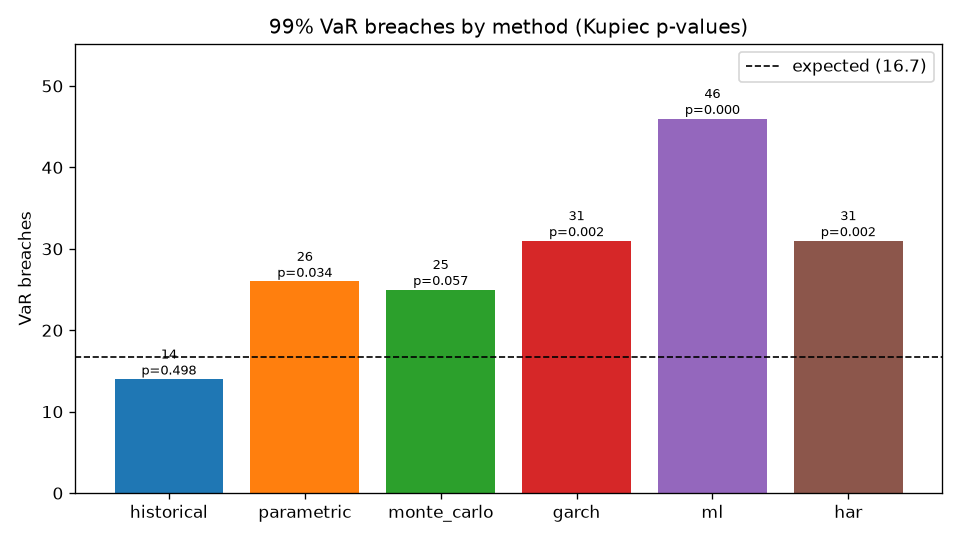
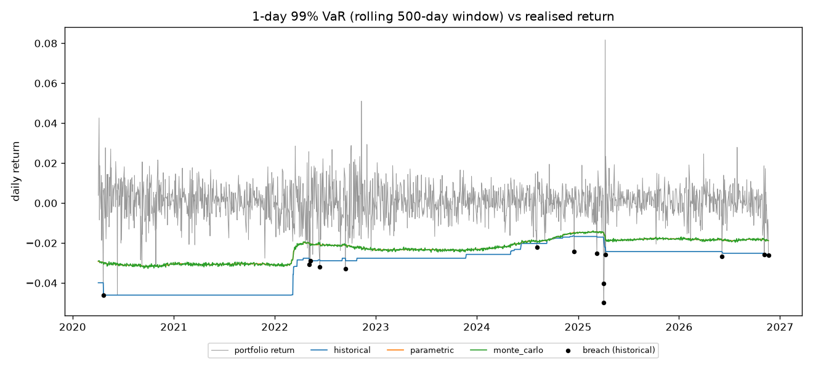
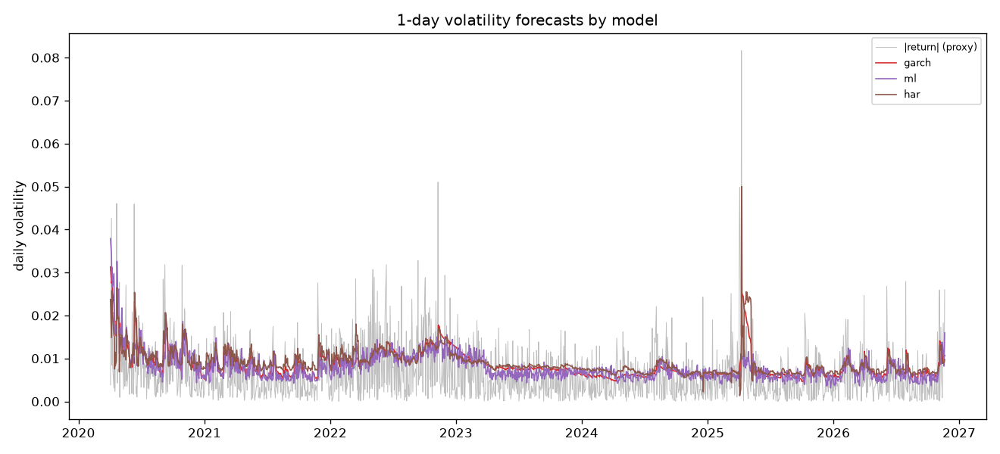

# market-risk-engine

1-day 99% Value-at-Risk (VaR) and Expected Shortfall (ES) for an equal-weight portfolio of 10 liquid assets. The project backtests three classical VaR methods and three volatility-model VaRs out of sample, and compares GARCH(1,1) with a gradient-boosting volatility forecaster.

Every number below comes from `results/`, written by `python run_all.py` on 2026-11-22 (see `results/run_metadata.json`).

## Setup

| | |
|---|---|
| Assets | SPY, QQQ, EFA, EEM, TLT, GLD, USO, AAPL, MSFT, JPM (equal weight, rebalanced daily) |
| Data | yfinance daily adjusted close, 2018-01-02 → 2026-11-20, cached in `data/prices.csv` |
| Returns | 2,234 daily simple returns |
| Risk measure | 1-day VaR and ES at 99%, reported as positive losses (fraction of portfolio value) |
| Estimation window | rolling 500 trading days |
| Monte Carlo | 10,000 scenarios per day, seed 42 |
| Vol models | refit every 20 days, filtered or predicted daily in between |

## Method

**VaR/ES.** A breach on day *t* means return_t < −VaR_t.
- *Historical simulation:* VaR is the empirical 99% quantile of losses (the "higher" order statistic, so a 500-day window has a 5-loss tail). ES is the mean of losses at or beyond VaR.
- *Parametric (variance-covariance, normal):* VaR = −μ + σ·z₀.₉₉ and ES = −μ + σ·φ(z₀.₉₉)/0.01, using the window's sample mean vector and covariance matrix.
- *Monte Carlo:* 10,000 draws from a multivariate normal with the window's mean and covariance; historical VaR/ES is then applied to the simulated portfolio returns.

**Backtest.** The forecast for day *t* uses returns *t*−500 … *t*−1 only. Each method is tested three ways, all with asymptotic χ² p-values:
- Kupiec POF test (correct breach frequency).
- Christoffersen independence test (no breach clustering).
- Conditional coverage (both together).

**Volatility models** (portfolio return; walk-forward; nothing after *t*−1 is used for day *t*):
- *GARCH(1,1)* (`arch`, constant mean, normal): refit on the last 500 days every 20 days; between refits the variance recursion is run forward with fixed parameters.
- *Gradient boosting* (LightGBM, gamma objective): the target is the next day's squared return. Features are |r| at lags 1–5 and realised variance (mean r²) over 1, 5, 22 and 66 days. The model is trained on the last 500 rows and refit every 20 days.
- *HAR-OLS baseline:* OLS of r² on 1-, 5- and 22-day realised variance, with the same windows as the ML model.
- *Evaluation:* forecasts are scored against the squared daily return (realised-variance proxy) with RMSE (in %²) and QLIKE = mean(log h + r²/h). Each forecast σ is turned into a zero-mean normal VaR/ES and backtested like the other methods.

**No-look-ahead check.** Tests shuffle all returns after a cut-off date and assert that every forecast up to the cut-off is unchanged. This covers the rolling VaR, GARCH, ML and HAR.

## Results

### Full-sample 99% VaR and ES (all 2,234 days)

| method | VaR | ES |
|---|---|---|
| historical | 2.76% | 4.21% |
| parametric (normal) | 2.26% | 2.60% |
| Monte Carlo (MVN) | 2.34% | 2.66% |

Historical ES is 1.52× historical VaR, while the normal methods put ES only 14–15% above VaR. The portfolio's loss tail is much fatter than a normal distribution allows.

### Rolling backtest, common period 2020-04-03 → 2026-11-20 (1,668 days, 16.68 breaches expected)

| method | breaches | breach rate | Kupiec p | independence p | cond. coverage p |
|---|---|---|---|---|---|
| historical | 14 | 0.84% | 0.498 | 0.096 | 0.199 |
| parametric | 26 | 1.56% | 0.034 | 0.0059 | 0.0024 |
| Monte Carlo | 25 | 1.50% | 0.057 | 0.051 | 0.024 |
| GARCH(1,1) | 31 | 1.86% | 0.0016 | 0.586 | 0.0060 |
| LightGBM | 46 | 2.76% | 2.96e-09 | 0.537 | 1.83e-08 |
| HAR-OLS | 31 | 1.86% | 0.0016 | 0.018 | 0.00042 |

The common period starts 66 days after the 500-day window because the volatility features need 66 days of history. That excludes the March 2020 crash. The three classical methods over their full forecast period, which includes it:

### Classical methods, full period 2019-12-30 → 2026-11-20 (1,734 days, 17.34 expected)

| method | breaches | Kupiec p | independence p | cond. coverage p |
|---|---|---|---|---|
| historical | 21 | 0.393 | 0.022 | 0.0503 |
| parametric | 37 | 3.76e-05 | 5.10e-06 | 6.15e-09 |
| Monte Carlo | 36 | 8.34e-05 | 4.91e-05 | 1.13e-07 |

### Volatility forecasts (1,668 days)

| model | RMSE (%²) | QLIKE |
|---|---|---|
| GARCH(1,1) | 2.372 | 0.633 |
| LightGBM | 2.423 | 0.753 |
| HAR-OLS | 2.484 | 1.518 |

### What the results show
- **Historical simulation is the only method whose breach count is consistent with 99% coverage** at the 5% level in both periods: Kupiec p = 0.498 (common period) and 0.393 (full period). Over the full period its breaches cluster (independence p = 0.022). Conditional coverage is borderline at p = 0.0503.
- **The normal methods under-cover.** Parametric and Monte Carlo agree closely: a portfolio of multivariate-normal returns is itself normal, so Monte Carlo only adds simulation noise. Including March 2020, they breach 37 and 36 times against 17.34 expected (Kupiec p < 0.0001).
- **GARCH gives the best volatility forecasts** (lowest QLIKE 0.633 and lowest RMSE 2.372) and its breaches are not clustered (independence p = 0.586). With normal tails it still breaches 31 times against 16.68 expected (Kupiec p = 0.0016).
- **LightGBM beats the HAR-OLS baseline on QLIKE (0.753 vs 1.518) but not GARCH.** Its VaR under-covers the most: 46 breaches, Kupiec p = 2.96e-09. On this data and design, gradient boosting did not improve on GARCH(1,1).

### Charts
- `results/figures/return_distribution.png`: return histogram with full-sample VaR lines
- `results/figures/var_backtest.png`: rolling VaR (historical, parametric, Monte Carlo) vs realised return, with historical breaches marked. The parametric line is hidden under Monte Carlo.
- `results/figures/breaches.png`: breach counts for all six methods with Kupiec p-values
- `results/figures/vol_forecasts.png`: GARCH, LightGBM and HAR forecasts vs |return|





## Limitations
- **One portfolio, one sample.** The results come from a single equal-weight portfolio over 2018–2026 and are not a general ranking of methods. With about 17 expected breaches, the χ² p-values are asymptotic approximations with low power.
- **Normal tails.** The volatility-model VaR assumes zero-mean normal returns, which drives GARCH's excess breaches. A Student-t GARCH or filtered historical simulation was not tried.
- **Noisy ML target.** The ML target is the noisy one-day squared return. A smoother multi-day target was not tried, and the hyperparameters were set once and not tuned, to avoid fitting to the test period.
- **Squared-return proxy.** The realised-volatility proxy is the squared daily return, because no intraday data was used. RMSE and QLIKE rank models consistently under this proxy, but their levels are noisy.
- **Survivorship and selection.** The tickers were chosen in 2026, so selection and survivorship bias are present.
- **Changing data.** Prices run to "latest" at download time; delete `data/prices.csv` or pass `--refresh` and the numbers will change.
- **Working directory.** Run scripts from the project root (paths are relative).

## How to run
```
py -3.11 -m venv .venv
.venv\Scripts\python -m pip install -e ".[dev]"
.venv\Scripts\python run_all.py            # ~10-20 s; downloads prices on first run
.venv\Scripts\python -m pytest --cov=mre   # 42 tests, synthetic data only
.venv\Scripts\python -m ruff check .
```
Then open `notebooks/analysis.ipynb`. If yfinance cannot download data, `run_all.py` stops with an error; it never substitutes synthetic data. `--synthetic` exists only for the smoke test and refuses to write into `results/`.

## Layout
```
src/mre/data.py      download, cache, validate prices
src/mre/returns.py   simple and portfolio returns
src/mre/var_es.py    historical / parametric / Monte Carlo VaR and ES
src/mre/backtest.py  rolling forecasts, Kupiec, Christoffersen, conditional coverage
src/mre/vol.py       GARCH(1,1), LightGBM, HAR-OLS walk-forward; RMSE / QLIKE
src/mre/report.py    charts and CSV output
run_all.py           end-to-end pipeline -> results/
tests/               pytest suite (synthetic data)
notebooks/           analysis.ipynb, a walkthrough of results/
```
